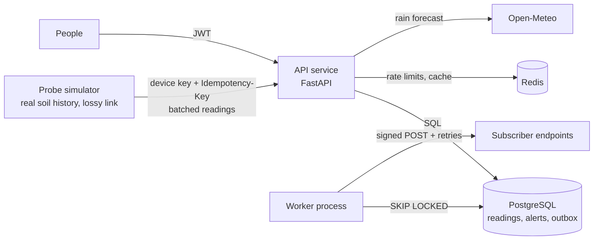
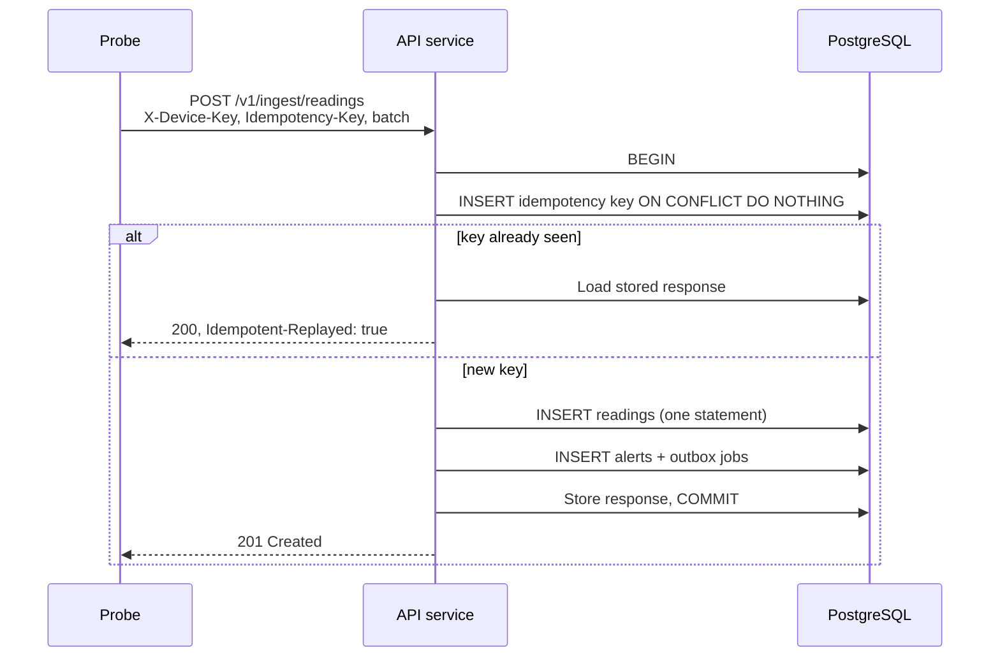
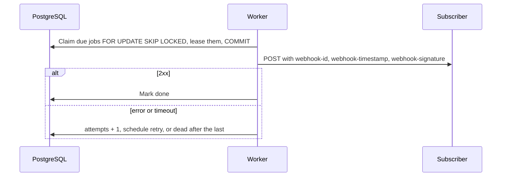
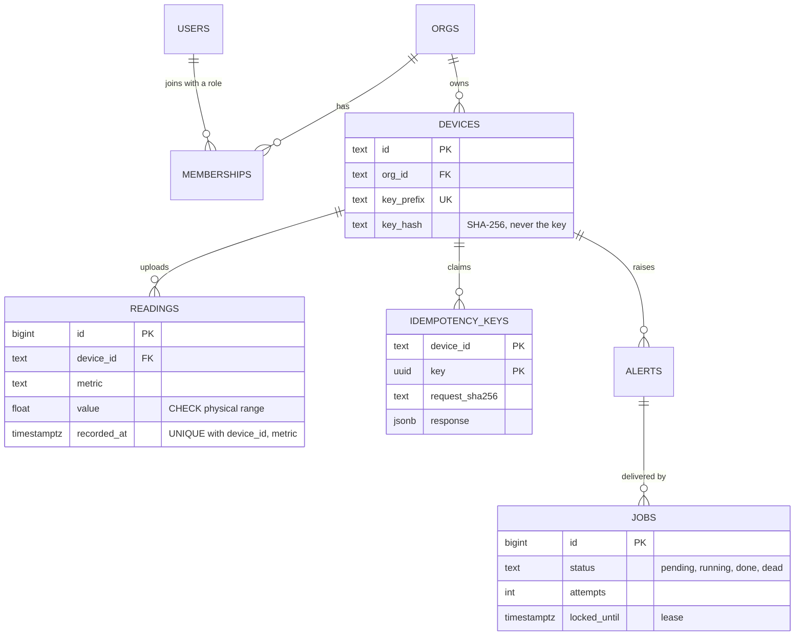

<div align="center">


# Tessel

**Multi-tenant telemetry backend for agricultural soil sensors**

Exactly-once ingestion&ensp;·&ensp;Tenant isolation&ensp;·&ensp;Signed webhooks

<p>
  
  
  
  
  
  
</p>

[Why](#why-tessel)&ensp;·&ensp;[Architecture](#architecture)&ensp;·&ensp;[Core flows](#core-flows)&ensp;·&ensp;[Results](#results)&ensp;·&ensp;[API](#api-overview)&ensp;·&ensp;[Decisions](#design-decisions)&ensp;·&ensp;[Quickstart](#quickstart)

</div>

---

## Why Tessel

Soil probes on weak rural links push batched readings. Tessel stores each reading exactly once, keeps every organization's data isolated, raises alerts within seconds, and notifies other systems through signed webhooks.

A probe on a 2G link often loses the response to its request, so it retries and the server sees the same batch twice. A worker can crash between saving an alert and sending it. One organization must never see another's fields. Each feature in Tessel exists to prevent a specific failure:

| Failure | Without it | How Tessel handles it |
|---|---|---|
| Lost responses on rural networks | Retries insert duplicate readings | `Idempotency-Key` per batch, claimed in the same transaction as the readings, plus a unique constraint |
| Crash between "save alert" and "send alert" | Alerts vanish silently | Transactional outbox: the alert and its delivery job commit together |
| Two workers grabbing the same job | Double delivery or lost work | `FOR UPDATE SKIP LOCKED` claims with leases |
| A forgotten `WHERE org_id = …` | Cross-tenant data leak | Org-scoped repositories, per-org roles, `404` for non-members |
| Flat readings in a dry spell | Constant false "stuck probe" alarms | Rules that require weather evidence, tuned on real data |
| Slow or failing weather API | Requests pile up and the API stalls | Timeouts, full-jitter retries, a circuit breaker and a stale fallback |
| A stolen probe | Indefinite unauthorized writes | Hashed, revocable device keys |
| Spoofed or replayed webhooks | Integrators act on forged events | HMAC signatures with timestamps ([Standard Webhooks](https://www.standardwebhooks.com/)) |

---

## Architecture

Two processes built from one image, two data stores, and one outside dependency. There's no hardware: a simulator replays real [ERA5-Land](https://open-meteo.com/en/docs/historical-weather-api) history from four climates as a fleet of probes, over a link that loses responses on purpose.



Alert rules are pure functions with no I/O, so they test in microseconds and are shared by the API, the worker and backfills.

---

## Core flows

### Idempotent ingestion

The probe derives a key from its device, first timestamp and metric, so a retry after a reboot sends the same key. Everything happens in one transaction: a retry either replays the stored response or does the work for the first time, never twice.



Concurrent retries with one key wait on the key's primary key, then see the first transaction's row. Reusing a key with a different body returns `422`. A unique constraint on `(device_id, metric, recorded_at)` is a second safety net.

### Alert delivery through the outbox

The API never calls a subscriber directly. A worker claims due jobs, sends signed webhooks outside any open transaction, and retries on a schedule of 1 min, 5 min, 30 min, 2 h and 6 h.



On `SIGTERM` the worker stops claiming, finishes the job in hand and exits. If it's killed outright, its lease expires and another worker picks the job up. Delivery is at-least-once, and receivers deduplicate on `webhook-id`.

---

## Data model

Every row that holds tenant data carries `org_id`, and the guarantees above are enforced by the schema itself, not only by the API.



---|---|
| `UNIQUE (device_id, metric, recorded_at)` | A reading can't be stored twice, even under two different idempotency keys |
| `PRIMARY KEY (device_id, key)` on idempotency keys | Concurrent retries serialize on one row |
| `(device_id, recorded_at DESC, id DESC)` index | Keyset pages come out of the index already sorted, with no sort step |
| Partial index on `jobs (run_at) WHERE status = 'pending'` | Workers find due jobs without scanning finished ones |
| Monthly range partitions on `recorded_at` (UTC bounds) | Indexes stay small; retention is `DROP TABLE`, not a bloating `DELETE` |

---

## Results

| Measurement | Result |
|---|---|
| Naive "flat for 24 h" stuck rule, false alarms on healthy soil | 2–26% of hours, depending on climate |
| Weather-aware stuck rule (flat while ≥ 2 mm of rain fell above freezing) | under 0.06% of hours |
| Eight concurrent retries of one batch against Postgres | stored once: one `201`, seven `200` |
| Load test with 20% of batches resent | pending: req/s, p50, p99 and duplicate count |

Rule rates come from 2022–2026 ERA5-Land data for Pune, Fresno, Lyon and Winnipeg. Load-test numbers will be published here with the machine they ran on.

---

## API overview

Tenant resources live under `/v1/orgs/{org_id}`. A caller who isn't a member of that org gets `404`, so other tenants stay invisible. Every error is returned as [RFC 9457](https://www.rfc-editor.org/rfc/rfc9457) `application/problem+json`. The full contract is at `/docs`.

| Endpoint | Auth | Purpose |
|---|---|---|
| `GET /v1/metrics` · `/v1/metrics/{name}` | None | Metric catalog: units and physical ranges |
| `GET`, `POST /v1/orgs/{org_id}/devices` | JWT + role | List devices; create one and receive its key once |
| `POST /v1/ingest/readings` | Device key + `Idempotency-Key` | Ingest up to 500 readings |
| `GET /v1/orgs/{org_id}/devices/{id}/readings` | JWT | Keyset-paginated readings, filterable by metric |
| `GET /health` · `/metrics` | None | Liveness, Prometheus metrics |

---

## Design decisions

Each decision is recorded as an ADR in [`docs/adr/`](docs/adr/).

| Decision | Trade-off accepted |
|---|---|
| **Postgres for data, the job queue and search** | One database is one scaling ceiling; Kafka or Elasticsearch pay off at much higher volume |
| **Transactional outbox, not Celery or Kafka** | Polling adds a little latency |
| **Deterministic batch keys plus a unique constraint** | An extra write per batch; old keys need expiring |
| **Weather-aware alert rules** | Needs rain and temperature alongside soil moisture |
| **JWT + rotating refresh tokens** | Access tokens can't be revoked early, so they last 15 minutes |
| **Org-scoped repositories** | An extra membership check per request |
| **Monthly partitions with UTC bounds** | Partition maintenance becomes a scheduled job |
| **Keyset pagination** | No jumping to page N, only next |
| **Real Postgres in tests** | Slower start-up than mocks, but locks and constraints are actually tested |

---

## Quickstart

> [!NOTE]
> Tessel is being built in public. These commands describe the target workflow and come online as each stage lands.

You need Docker with Compose v2.

```bash
git clone https://github.com/sdukea/tessel.git && cd tessel
```

```bash
docker compose up --build
```

Compose starts Postgres, Redis and MinIO, runs migrations once, then starts the API and the worker. Open <http://localhost:8000/docs>.

To run the tests (they use `TESSEL_TEST_DATABASE_URL` if set, otherwise an embedded Postgres):

```bash
uv run pytest -q
```

---

## Tech stack

Python 3.12 · FastAPI · Pydantic v2 · psycopg 3 · PostgreSQL 17 · Redis 7 · MinIO · httpx · PyJWT · Argon2 · pytest · Hypothesis · Docker · GitHub Actions

<div align="center">

<sub>Syon Duke Abraham</sub>

</div>
