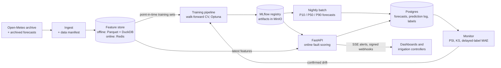

<div align="center">


# Tessel

**Soil-moisture forecasting and sensor-fault detection, built from first principles and shipped like production ML**

24-hour quantile forecasts&ensp;·&ensp;Fault detection on rare events&ensp;·&ensp;Leakage-safe evaluation

<p>
  
  
  
  
  
  
</p>

[Why](#why-tessel)&ensp;·&ensp;[Architecture](#architecture)&ensp;·&ensp;[Data](#data)&ensp;·&ensp;[Results](#results)&ensp;·&ensp;[From scratch](#built-from-scratch)&ensp;·&ensp;[Decisions](#design-decisions)

</div>

---

## Why Tessel

Farms irrigate on fixed schedules or on a single soil probe's reading. Too little water stresses the crop; too much wastes water and leaches nutrients. Probes also fail quietly: a stuck sensor keeps reporting a healthy value while the field dries out.

Tessel answers two questions for every field:

1. **Will the soil drop below the crop's stress threshold in the next 24 hours?** A quantile forecast (P10, P50, P90) of soil moisture drives the irrigation decision.
2. **Is this probe still telling the truth?** A fault classifier flags stuck, spiking, drifting and dropping-out sensors, which make up about 1–2% of readings.

Most ML projects fail in production for the same handful of reasons. Each part of Tessel exists to prevent one of them:

| Trap | What goes wrong | How Tessel handles it |
|---|---|---|
| Random train/test splits on time series | The model is tested on the past it trained on, and scores look far better than reality | Walk-forward folds with a gap equal to the 24 h horizon |
| Training on observed future weather | The model gets a perfect rain forecast it won't have in production | Trains on archived weather *forecasts*, as issued at prediction time |
| Naive feature joins | Features from after the prediction moment leak into training | A feature store with point-in-time-correct joins |
| Training-serving skew | Serving computes features differently and accuracy collapses silently | One feature registry for both readers, plus a live skew check |
| No baseline | A "good" score that a trivial rule would beat | Persistence, seasonal naive and a fixed irrigation schedule set the bar |
| Accuracy on a 1% problem | A model that never flags a fault scores 99% | PR-AUC, per-fault recall and a threshold chosen from the costs of each error |
| A single-number forecast | No way to act on risk | Calibrated P10/P50/P90 quantiles, with coverage checked per climate |
| Silent decay after launch | The world drifts away from the training data | PSI and KS drift monitors, confirmed by error on labels that arrive a day later |
| Swapping models on an offline win | A regression reaches every field at once | A CI eval gate, then shadow deployment, then promotion with one-command rollback |

---

## Architecture

Tessel has two layers. The **ML core** turns raw history into evaluated, versioned models. The **platform** serves them, logs every prediction, and feeds labels back for monitoring.



Forecasts are needed once a day per field, so they're computed in a nightly batch and cached. Fault scores run online on each incoming window, because a stuck probe should be caught within the hour. If the model or its features are unavailable, the API returns a schedule-based recommendation flagged as a fallback rather than an error.

---

## Data

| | |
|---|---|
| Source | [Open-Meteo historical weather API](https://open-meteo.com/en/docs/historical-weather-api) (ERA5-Land reanalysis) and its [previous-runs API](https://open-meteo.com/en/docs/previous-runs-api) (day-ahead forecasts as issued, January 2024 onward) |
| Coverage | 50 sites across arid, temperate, monsoon and continental climates, 2016 onward, hourly |
| Size | ≈ 3.9 million rows |
| Variables | Soil moisture at 0–7 cm and 7–28 cm, precipitation, temperature, humidity, reference evapotranspiration |
| Fault labels | Stuck, spike, drift and dropout faults injected into the real series at known positions |
| Versioning | Every Parquet file's content hash, the API parameters and the download date in a committed `data/manifest.json` |

Reanalysis is smoother than a real probe. Validating on in-situ sensors from the [International Soil Moisture Network](https://ismn.earth/) is on the roadmap.

---

## Results

All models are scored by one evaluation harness: walk-forward folds, per climate regime, with confidence intervals, and compared fold by fold. Numbers are filled in as each model is built and are reproducible with `python -m pipelines.train --config <config>`.

**24-hour soil-moisture forecast**

| Model | MAE (m³/m³) | Worst regime MAE | Stress-crossing recall | P10–P90 coverage |
|---|---|---|---|---|
| Persistence (baseline) | pending | pending | pending | n/a |
| Seasonal naive (baseline) | pending | pending | pending | n/a |
| Linear regression (from scratch) | pending | pending | pending | n/a |
| LightGBM, tuned | pending | pending | pending | pending |
| Quantile MLP (tessel.nn) | pending | pending | pending | pending |
| Quantile MLP and 1-D CNN (PyTorch) | pending | pending | pending | pending |

**Sensor-fault detection** reports PR-AUC, recall per fault type, and expected cost per 1,000 windows at the cost-tuned threshold, comparing z-score, IQR and isolation forest against supervised classifiers.

**Irrigation backtest** reports water used and crop-stress hours for the forecast-driven policy against a fixed every-three-days schedule and a perfect-foresight oracle.

---

## Built from scratch

The core algorithms are implemented in NumPy and kept in the repository as tested references. Each one is checked against an established library in CI.

| Component | Checked against |
|---|---|
| Linear and ridge regression (gradient descent and normal equation) | scikit-learn `Ridge` |
| Regression tree and random forest | scikit-learn `DecisionTreeRegressor` |
| Gradient boosting with squared and absolute loss | LightGBM |
| Isolation forest | scikit-learn `IsolationForest` |
| **tessel.nn**: reverse-mode autograd, `Module`, `Linear`, `Dropout`, `LayerNorm`, Xavier and Kaiming init | PyTorch, plus finite-difference gradient checks for every operation |
| Losses: MSE, Huber, quantile (pinball), BCE from logits, focal | PyTorch |
| Optimizers and schedules: SGD, momentum, Adam, AdamW, warmup + cosine | `torch.optim` |

Production paths use the libraries. The from-scratch versions exist to show the internals are understood, and to catch surprises when library versions change.

---

## Design decisions

Each decision is recorded as an ADR in [`docs/adr/`](docs/adr/).

| Decision | Trade-off accepted |
|---|---|
| **Gradient boosting as champion** until a deep model beats it under the same protocol | Trees can't extrapolate beyond the range seen in training |
| **Quantile forecasts** instead of a single value | Three outputs to calibrate and monitor |
| **Archived forecasts as inputs** instead of observed weather | Day-ahead archived forecasts start in January 2024, so the forecast-aware model trains on fewer years |
| **Feature store with point-in-time joins** | More infrastructure than a feature function in a notebook |
| **Cost-tuned fault threshold** | Error costs are estimates and need revisiting with real operators |
| **Batch forecasts, online fault scoring** | Two serving paths to operate |
| **Shadow deployment and an eval gate** before any model swap | Slower releases, and labels arrive 24 hours late |
| **Drift statistics plus delayed-label error** for retraining triggers | Alert thresholds need tuning against false alarms |

---

## Quickstart

> [!NOTE]
> Tessel is being built in public. These commands describe the target workflow and come online as each stage lands.

```bash
git clone https://github.com/sdukea/tessel.git && cd tessel
```

```bash
uv sync
```

```bash
uv run python -m pipelines.ingest
```

```bash
uv run python -m pipelines.train --config configs/champion.yaml
```

```bash
docker compose up --build
```

`pipelines.ingest` downloads the data and writes its manifest. `pipelines.train` builds point-in-time training sets, trains, evaluates in the harness and registers the model in MLflow. Compose starts the API, worker, Postgres, Redis, MinIO and MLflow.

---

## Tech stack

Python 3.12 · NumPy · pandas · DuckDB · scikit-learn · LightGBM · PyTorch · Optuna · MLflow · FastAPI · Pydantic · PostgreSQL + pgvector · Redis · MinIO · pytest · Hypothesis · Docker · GitHub Actions

<div align="center">

<sub>Syon Duke Abraham</sub>

</div>
