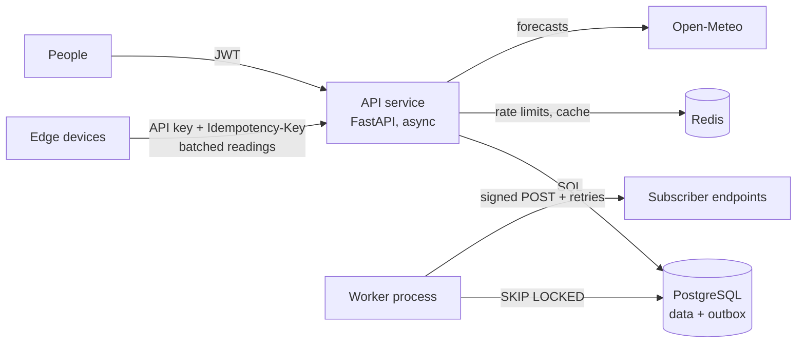
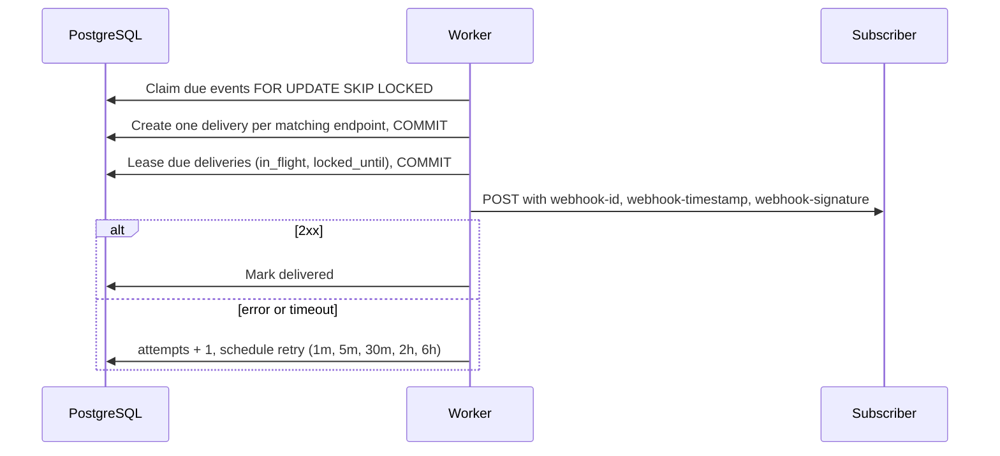

# Tessel

**A multi-tenant telemetry backend for agricultural edge sensors.**

Devices on unreliable rural networks push batched soil readings. Tessel stores each reading exactly once, keeps every organization's data isolated, raises alerts, and notifies other systems through signed webhooks.


---

## Why Tessel

A soil probe on a weak 2G link often loses the response to its request, so it retries and the server sees the same batch twice. A worker can crash between saving an alert and sending it. One organization must never see another's fields. Each feature in Tessel exists to prevent a specific failure:

| Failure | Without it | How Tessel handles it |
|---|---|---|
| Lost responses on rural networks | Retries insert duplicate readings | `Idempotency-Key` per batch, enforced by a Postgres unique constraint |
| Crash between "save alert" and "send alert" | Alerts vanish silently | Transactional outbox: the alert and its event commit together |
| Two workers grabbing the same job | Double delivery or lost work | `FOR UPDATE SKIP LOCKED` claims |
| A forgotten `WHERE org_id = …` | Cross-tenant data leak | Tenant-scoped repositories that always filter by org |
| Slow or failing weather API | Requests pile up and the API stalls | Timeouts, retries with jitter, a Redis cache and a circuit breaker |
| A stolen device | Indefinite unauthorized writes | Hashed, revocable API keys with rotation |
| Spoofed or replayed webhooks | Integrators act on forged events | HMAC signatures with timestamps ([Standard Webhooks](https://www.standardwebhooks.com/)) |

---

## Architecture

Two processes built from one image, two data stores, and one outside dependency.



The code follows a ports-and-adapters layout. `domain/` is plain Python with no I/O and holds the readings, alert rules and interfaces. `infra/` implements those interfaces with Postgres, Redis and HTTP. Business rules can therefore be tested in milliseconds without a database.

---

## Core flows

### Idempotent ingestion

The device generates a UUID per batch and sends it as `Idempotency-Key`. All the work happens in one transaction, so a retry either replays the stored response or does the work for the first time. It never does it twice.


Reusing a key with a different body returns `422`. A second unique constraint on `(device_id, metric, recorded_at)` acts as a safety net.

### Alert delivery through the outbox

The API never calls a subscriber directly. A separate worker claims due events, sends signed webhooks outside any open transaction, and retries with backoff.



If a worker crashes mid-send, its lease expires and another worker picks the delivery up. Delivery is at-least-once, and receivers deduplicate on `webhook-id`.

---

## API overview

Tenant resources live under `/v1/orgs/{org_id}`. A caller who isn't a member of that org gets `404`, so other tenants stay invisible. Every error is returned as [RFC 9457](https://www.rfc-editor.org/rfc/rfc9457) `application/problem+json`. The full contract is at `/docs`.

| Endpoint | Auth | Purpose |
|---|---|---|
| `POST /v1/auth/login` · `/refresh` · `/logout` | Password / refresh token | 15-min access JWT with rotating refresh tokens |
| `/v1/orgs/{org_id}/farms` · `/devices` | JWT + role | Manage farms and devices |
| `GET /v1/orgs/{org_id}/devices/{id}/readings` | JWT | Keyset-paginated readings |
| `POST /v1/ingest/readings` | Device key + `Idempotency-Key` | Ingest up to 500 readings |
| `GET /v1/orgs/{org_id}/farms/{id}/irrigation-advice` | JWT | Soil moisture + rain forecast → `irrigate` / `hold` |
| `/v1/orgs/{org_id}/webhooks` | JWT + role | Register endpoints, view and redeliver deliveries |
| `GET /health` · `/ready` · `/metrics` | None | Liveness, readiness, Prometheus |

---

## Capacity

The design target is 1,000 organizations × 25 devices, each taking a reading every minute and uploading every 5 minutes.

| Metric | Estimate |
|---|---|
| Requests | ≈ 83 req/s |
| Rows written | ≈ 417 rows/s, ≈ 36M rows/day |
| Ingestion SLO | p95 < 200 ms at 100 req/s |

With batching and an index on `(device_id, recorded_at DESC, id DESC)`, a single Postgres instance handles this write rate. Table growth is the first ceiling, which leads to time partitioning and retention. Load-test results from Locust (`load/locustfile.py`) will be published here.

---

## Design decisions

Each decision is recorded as an ADR in [`docs/adr/`](docs/adr/).

| Decision | Trade-off accepted |
|---|---|
| **Async FastAPI**: the workload is I/O-bound | Blocking calls inside async routes must be avoided |
| **Postgres for data and the job queue** | One database is one scaling ceiling |
| **Redis for rate limits and cache** | One more system to run; ingestion fails open and login fails closed when Redis is down |
| **JWT + rotating refresh tokens** | Access tokens can't be revoked early, so they last 15 minutes |
| **Hashed device API keys** | Keys live on hardware that can be stolen, so revocation and rotation are required |
| **Tenant-scoped repositories** | An extra membership lookup per request |
| **Transactional outbox, not Celery or Kafka** | Polling adds a little latency; Kafka pays off at much higher throughput |
| **Real Postgres in tests (Testcontainers)** | Slower start-up, and CI needs Docker |
| **Keyset pagination** | No jumping to page N, only next and previous |

---

## Quickstart

You need Docker with Compose v2.

```bash
git clone https://github.com/sdukea/tessel.git
```

```bash
cd tessel && cp .env.example .env
```

```bash
docker compose up --build
```

Compose starts Postgres and Redis, runs migrations once, and then starts the API and the worker. Open <http://localhost:8000/docs>.

To run the tests (they need only a running Docker daemon):

```bash
uv run pytest -q
```

---

## Tech stack

Python 3.12 · FastAPI · Pydantic v2 · SQLAlchemy 2 (async) · Alembic · PostgreSQL 17 · Redis 7 · httpx · PyJWT · Argon2 · structlog · Prometheus · pytest · Testcontainers · Locust · Docker · GitHub Actions

<div align="center">

<sub>Syon Duke Abraham</sub>

</div>
